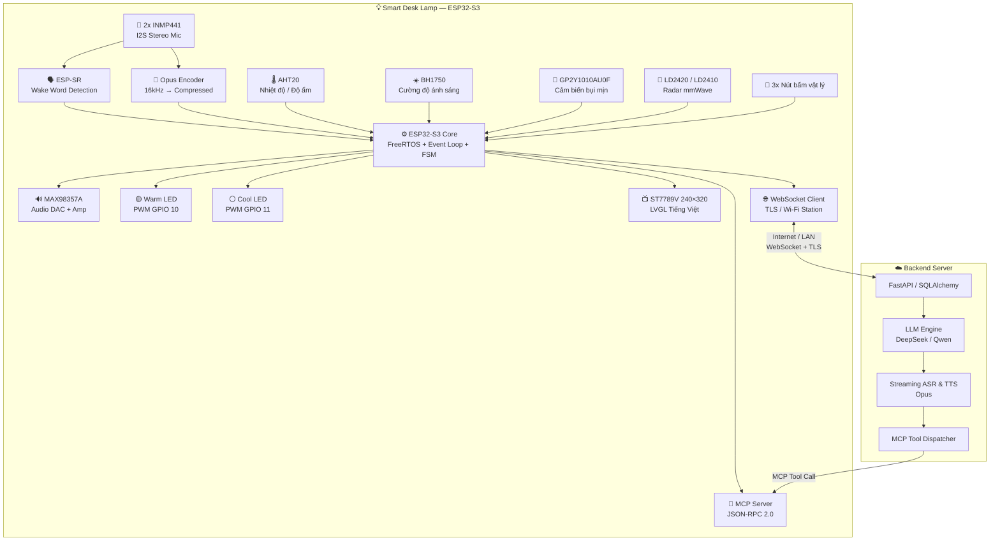

<div align="center">

# 💡 Smart Desk Lamp AI
### Đèn Bàn Thông Minh Tích Hợp Trợ Lý Giọng Nói AI

**Đồ án PBL3 — IoT & Embedded AI**

[](https://github.com/espressif/esp-idf)
[](https://www.espressif.com/en/products/socs/esp32-s3)
[](https://modelcontextprotocol.io/)
[](LICENSE)

*Hệ thống đèn bàn thông minh học tập / làm việc đa chức năng, tích hợp cảm biến bảo vệ thị lực & sức khỏe môi trường, màn hình giao diện tiếng Việt và trợ lý giọng nói AI tương tác thời gian thực thông qua giao thức **Model Context Protocol (MCP)**.*

</div>

---

## 📑 Mục Lục

| # | Nội dung |
|---|----------|
| 1 | [Giới thiệu tổng quan](#1-giới-thiệu-tổng-quan) |
| 2 | [Kiến trúc hệ thống](#2-kiến-trúc-hệ-thống) |
| 3 | [Sơ đồ kết nối phần cứng (Pinout)](#3-sơ-đồ-kết-nối-phần-cứng-pinout) |
| 4 | [Các tính năng cốt lõi](#4-các-tính-năng-cốt-lõi) |
| 5 | [Hệ thống công cụ MCP](#5-hệ-thống-công-cụ-mcp-model-context-protocol) |
| 6 | [Cấu trúc mã nguồn Firmware](#6-cấu-trúc-mã-nguồn-firmware) |
| 7 | [Hướng dẫn cài đặt & nạp Firmware](#7-hướng-dẫn-cài-đặt-và-nạp-firmware) |
| 8 | [Bản quyền & Tham khảo](#8-bản-quyền--tham-khảo) |

---

## 1. Giới thiệu tổng quan

Dự án phát triển một thiết bị **Đèn bàn học thông minh** kết hợp trợ lý AI dành cho học sinh, sinh viên và người làm việc văn phòng. Thiết bị không chỉ dừng lại ở việc chiếu sáng mà còn đóng vai trò một người bạn đồng hành thông minh.

<table>
<tr>
<td width="50%">

### 🌡️ Môi trường & Sức khỏe
- **Chiếu sáng sinh học**: Điều chỉnh nhiệt độ màu (Warm/Cool) và độ sáng bảo vệ mắt dựa trên cảm biến ánh sáng BH1750
- **Giám sát môi trường**: Theo dõi nhiệt độ, độ ẩm (AHT20) và cảnh báo bụi mịn (GP2Y1010AU0F)

</td>
<td width="50%">

### 🤖 AI & Giọng nói
- **Radar hiện diện mmWave** (LD2420/LD2410): Nhận biết người dùng, nhắc nhở nghỉ ngơi chống mỏi mắt, gù lưng
- **Trợ lý giọng nói**: Đàm thoại 2 chiều qua micro stereo & loa I2S, kết nối LLM (Qwen, DeepSeek...)
- **MCP Server**: Mô hình AI chủ động ra lệnh đọc cảm biến, điều khiển đèn

</td>
</tr>
</table>

---

## 2. Kiến trúc hệ thống



---

## 3. Sơ đồ kết nối phần cứng (Pinout)

Phần cứng được thiết kế tối ưu trên vi điều khiển **ESP32-S3 (WROOM-1 / DevKit)**:

| Phân hệ | Linh kiện | Chân GPIO ESP32-S3 | Chức năng / Ghi chú |
|:---|:---|:---|:---|
| 🎤 **Microphone I2S** | 2× INMP441 | `GPIO 5` (BCLK) `GPIO 4` (WS) `GPIO 6` (SD) | Thu âm Stereo 16-bit 16kHz. Mic 1: L/R → GND · Mic 2: L/R → 3V3 |
| 🔊 **Loa Audio DAC** | MAX98357A | `GPIO 15` (BCLK) `GPIO 16` (WS) `GPIO 17` (DIN) `GPIO 18` (SD/EN) | Phát âm thanh 24kHz. GPIO18 kéo cao để kích hoạt Amp |
| 📺 **Màn hình LCD** | ST7789V 240×320 SPI | `GPIO 38` (SCLK) `GPIO 39` (MOSI) `GPIO 40` (RST) `GPIO 19` (DC) `GPIO 20` (CS) | LVGL 9.x nằm ngang 320×240. ⚠️ GPIO19/20 dùng SPI → nạp qua UART |
| 🌡️ **Cảm biến I2C** | AHT20 + BH1750 | `GPIO 41` (SDA) `GPIO 42` (SCL) | I2C 100kHz · AHT20 `0x38`: Temp/Hum · BH1750 `0x23`: Lux |
| 💨 **Cảm biến Bụi** | GP2Y1010AU0F | `GPIO 9` (LED Ctrl) `ADC1 CH0` (GPIO 1/2) | LED Active-Low. Đọc tín hiệu Analog → nồng độ bụi μg/m³ |
| 📡 **Radar mmWave** | HLK-LD2420/10 | `GPIO 47` (TX) `GPIO 48` (RX) `GPIO 14` (Digital OUT) | UART 115200 baud · GPIO14 báo hiệu có người |
| 💡 **LED Đôi (PWM)** | 2 kênh Mosfet | `GPIO 10` (Warm LED) `GPIO 11` (Cool LED) | LEDC driver PWM 0–100% độc lập từng kênh |
| 🔘 **Nút bấm** | 3× Push Button | `GPIO 13` (Up/Vol+) `GPIO 12` (Down/Vol−) `GPIO 8` (Toggle/Config) | Active-Low với nội trở. Giữ GPIO8 lúc boot → vào chế độ cấu hình Wi-Fi |

---

## 4. Các tính năng cốt lõi

### 🖥️ 4.1. Màn hình Dashboard & Biểu cảm Robot (LVGL 9.x)

Hỗ trợ **tiếng Việt đầy đủ** với 2 font tối ưu cho nhúng: `font_vi_13` và `font_vi_24`.

Giao diện **đa tầng (Multi-layer)**:

```
┌─────────────────────────────────────┐
│  Tầng 1: Dashboard                  │
│  ⏰ Đồng hồ số · 📅 Lịch · 🌡️ Env  │
├─────────────────────────────────────┤
│  Tầng 2: Robot Eyes                 │
│  👀 Mắt động: Chớp · Biểu cảm FSM  │
│  😐 Idle → 👂 Listening → 🤔 Think  │
├─────────────────────────────────────┤
│  Tầng 3: Chat Bubble                │
│  💬 Văn bản người dùng              │
│  🤖 Phản hồi từ trợ lý AI          │
└─────────────────────────────────────┘
```

### 🎵 4.2. Xử lý âm thanh độ trễ thấp

- **ESP-SR**: Nhận diện từ khóa đánh thức (Wake Word) hoàn toàn offline
- **Opus Codec**: Mã hóa / giải mã âm thanh nén thời gian thực, tiết kiệm băng thông và giảm tối đa độ trễ

---

## 5. Hệ thống công cụ MCP (Model Context Protocol)

Firmware tích hợp **MCP Server** chuẩn JSON-RPC 2.0. Mô hình AI từ xa có thể gọi trực tiếp các công cụ dưới đây:

### 💡 Nhóm Đèn

| MCP Tool | Tham số | Mô tả |
|:---|:---|:---|
| `Lamp.set_power` | `{"state": bool}` | Bật (`true`) / Tắt (`false`) đèn bàn |
| `Lamp.set_brightness` | `{"value": int}` | Đặt độ sáng tổng thể từ `0` → `100` |
| `Lamp.set_color_temp` | `{"value": int}` | Nhiệt độ màu: Vàng ấm (`0`) → Trắng mát (`100`) |
| `Lamp.get_state` | *(không có)* | Trả về trạng thái hiện tại: nguồn, độ sáng, màu sắc |

### 🌿 Nhóm Môi trường

| MCP Tool | Tham số | Mô tả |
|:---|:---|:---|
| `self.environment.get_readings` | *(không có)* | Nhiệt độ (°C), Độ ẩm (%) từ AHT20 · Lux từ BH1750 |
| `self.environment.get_dust` | *(không có)* | Nồng độ bụi mịn PM từ cảm biến quang học GP2Y10 |
| `self.environment.get_presence` | *(không có)* | Trạng thái phát hiện người ngồi & khoảng cách từ Radar |

---

## 6. Cấu trúc mã nguồn Firmware

Firmware được tinh gọn và tối ưu riêng cho dự án:

```
xiaozhi-esp32/
│
├── 📄 CMakeLists.txt                   # Cấu hình build ESP-IDF
├── 📄 sdkconfig.defaults               # Cấu hình mặc định (PSRAM, Flash, ESP32-S3)
│
└── 📁 main/
    ├── 📄 main.cc                      # app_main: khởi tạo NVS & chạy Application
    ├── 📄 application.cc / .h          # Event loop trung tâm & điều phối State Machine
    ├── 📄 device_state_machine.cc      # FSM trạng thái (Idle → Listening → Speaking...)
    ├── 📄 mcp_server.cc / .h           # MCP Server thực thi lệnh từ LLM
    │
    ├── 📁 audio/                       # Audio pipeline: I2S driver, VAD, ESP-SR, Opus
    ├── 📁 display/                     # Driver ST7789, LVGL Theme, Text Glyph
    ├── 📁 protocols/                   # WebSocket protocol & binary packet format
    ├── 📁 assets/                      # Âm báo & ngôn ngữ tiếng Việt (vi-VN)
    │
    └── 📁 boards/
        ├── 📁 common/                  # Board interface chuẩn, quản lý nguồn & Wi-Fi
        └── 📁 my-custom-board/         # ⭐ DRIVER PHẦN CỨNG RIÊNG CỦA ĐỒ ÁN
            ├── 📄 config.h             # GPIO pinout, thông số màn hình & cảm biến
            ├── 📄 my-custom-board.cc   # Logic bo mạch & giao diện LVGL
            ├── 📄 my_board_audio_codec.cc  # Audio codec I2S stereo
            ├── 📄 font_vi_13.c / 24.c  # Bộ font tiếng Việt (13px & 24px)
            ├── 📁 io/                  # Điều khiển nút bấm & LED PWM
            └── 📁 sensors/             # AHT20, BH1750, GP2Y10, Radar LD2420
```

---

## 7. Hướng dẫn cài đặt và nạp Firmware

### 7.1. Yêu cầu môi trường

| Công cụ | Phiên bản yêu cầu |
|:---|:---|
| **ESP-IDF** | v6.0.2+ (khuyến nghị) hoặc v5.5+ |
| **Python** | 3.10+ |
| **Cáp nạp** | Type-C qua UART (CP2102 / CH340) |

### 7.2. Các bước biên dịch và nạp

**Bước 1 — Mở terminal ESP-IDF** (ESP-IDF 6.0 CMD hoặc VS Code Extension):

```bash
cd D:\xiaozhi-esp32\xiaozhi-esp32
```

**Bước 2 — Thiết lập target:**

```bash
idf.py set-target esp32s3
```

**Bước 3 — Biên dịch:**

```bash
idf.py build
```

**Bước 4 — Nạp & theo dõi** (thay `COMx` bằng cổng COM của thiết bị):

```bash
idf.py -p COMx flash monitor
```

### 7.3. Cấu hình mạng Wi-Fi ban đầu

> [!NOTE]
> Khi bật nguồn lần đầu (hoặc **giữ nút Toggle — GPIO 8** trong lúc khởi động), màn hình sẽ hiển thị trạng thái phát Wi-Fi AP.

Dùng điện thoại hoặc máy tính kết nối vào mạng Wi-Fi do thiết bị phát ra, sau đó điền:
- **SSID / Mật khẩu** mạng Wi-Fi gia đình
- **Địa chỉ Backend Server**

---

## 8. Bản quyền & Tham khảo

**Giấy phép**: Toàn bộ dự án phát hành theo **[MIT License](LICENSE)**.

| Nguồn tham khảo | Liên kết |
|:---|:---|
| Kiến trúc nền tảng & Audio/WebSocket pipeline | [XiaoZhi ESP32](https://github.com/78/xiaozhi-esp32) |
| Giao thức điều khiển thiết bị AI | [Model Context Protocol (MCP)](https://modelcontextprotocol.io/) |
| Thư viện đồ họa nhúng | [LVGL 9.x](https://lvgl.io/) |

---

<div align="center">

Made with ❤️ for **PBL3** — Đại học Đà Nẵng

</div>
